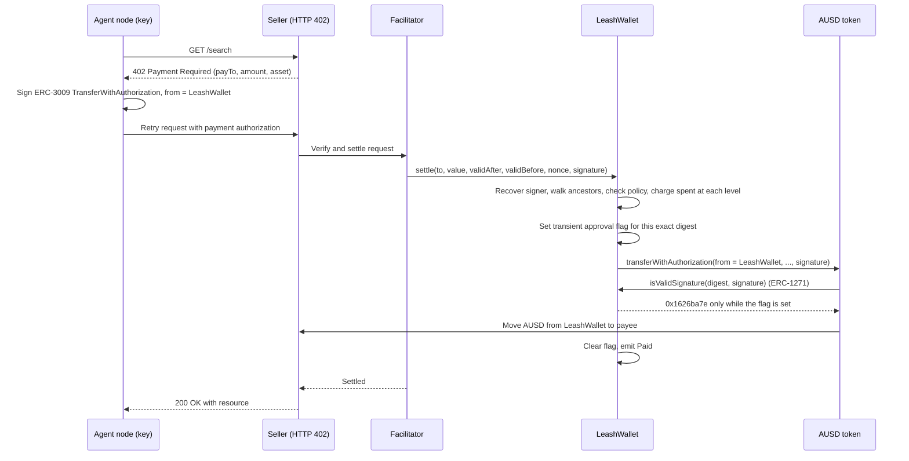

# Leash

Leash is a spending allowance for AI agents that they can split among sub-agents, with the rules enforced onchain at every payment.

## Deployment and links

| Item | Value |
| --- | --- |
| LeashWallet (Base Sepolia) | `0xD6a92b451468f1f4decA6Fa27Fd8c367163D653c` |
| Verified source (Blockscout) | https://base-sepolia.blockscout.com/address/0xD6a92b451468f1f4decA6Fa27Fd8c367163D653c#code |
| Basescan | https://sepolia.basescan.org/address/0xD6a92b451468f1f4decA6Fa27Fd8c367163D653c |
| AUSD (Base Sepolia) | `0xa9012a055bd4e0eDfF8Ce09f960291C09D5322dC` (EIP-712 domain "Agora Dollar" / "1", 6 decimals) |
| Demo video | (link coming) |

## The problem

A prompt-injected agent can make perfectly valid transfers to an attacker. Allowances (ERC-20 `approve`, ERC-2612 `permit`, Permit2) bound the total amount, but they cannot restrict who gets paid, cap a single payment, or be split among sub-agents while the total stays bounded. Once an agent holds the allowance, every payment it signs is accepted.

## How it works



The facilitator only ever calls `LeashWallet.settle()`. It never submits the authorization to AUSD directly. Because the token asks the wallet for permission through ERC-1271, and the wallet answers only inside a `settle()` call for that exact digest, a signed authorization sent straight to AUSD is refused.

## Policy model

- **Tree.** A root node is the orchestrator. Children and grandchildren are delegated from their parent. Maximum depth is 2 (root depth 0, child depth 1, grandchild depth 2).
- **Budget.** Each node has a `cap` and a running `spent`. A payment charges every node from the signer up to the root, so a child can never spend more than its own cap or its parent's remaining budget.
- **Per-call limit.** `maxPerCall` caps any single payment at that node.
- **Payee allowlists.** A global allowlist (owner-managed) applies to every payment. A node can also be `restricted`, in which case it may only pay payees in its own allowlist.
- **Expiry.** A node stops paying at its `expiry` timestamp.
- **Pause.** The owner can pause any node. An ancestor can pause a descendant subtree with a signed `PauseChild` message.
- **Balance floor.** The owner can set a floor that the wallet balance must stay above after each payment.

Child nodes are created with an EIP-712 `CreateChild` message signed by the parent's key. Anyone can relay that message, but a child cannot exceed its parent's limits.

## Why AUSD

AUSD supports the ERC-3009 `transferWithAuthorization` overload that takes a bytes signature and falls back to ERC-1271 when the signer is a contract. This lets the wallet itself be the `from` address and authorize each transfer through its own logic. The overload selector is `0xcf092995`. Live testnet checks confirmed the overload and the fallback path on Base Sepolia AUSD.

## Prior art and what is new

Delegation and session-key systems already exist and are the reference points here. MetaMask's Delegation Framework and ERC-7710 define delegation between smart accounts, and x402 has an `erc7710` method for them. Coinbase Spend Permissions, Safe with Zodiac modules, and session-key wallets cover related ground. x402 issue #2641 discusses a view-only ERC-1271 approach for the default `eip3009` rail. Draft ERC-8366 (ethereum/ERCs PR #1929) is still a draft.

What Leash adds is a stateful ERC-1271 gate. The wallet keeps decrementing hierarchical budgets and payee allowlists, and it accepts a signature only during the `settle()` call that is charging for it. The mechanism uses EIP-1153 transient storage. It brings these controls to x402's default `eip3009` rail with an unmodified token. It does need a Leash-aware facilitator that calls `settle()` instead of the token, and the token itself refuses a direct-to-token bypass.

## What is real

| Piece | Status |
| --- | --- |
| LeashWallet | Deployed and verified on Base Sepolia (address above). |
| Payments | Real testnet AUSD moves through `settle()`. Example paid `/search` call: https://sepolia.basescan.org/tx/0x92f81d12dbfb1308da96788864dcde293b1068f1039352dbdd35cce1ca005048 |
| Blocked payment | A `/premium-intel` payment to a non-allowlisted payee reverted onchain with `PayeeNotAllowed(0)`: https://sepolia.basescan.org/tx/0xf1548f0b1fc7ccb4ec7e4aa437cb12a85d883f9c6a13e507b4114bb3e5a36a16 |
| Direct-to-AUSD bypass | A blocked payment's signature, replayed straight to AUSD, was rejected: https://sepolia.basescan.org/tx/0xfe6134808d686cf39f454c843ff6cd3453856bfeef7f2733b7ab1e9c9ef94bfc |
| Search and scrape | The seller's `/search` and `/scrape` routes call Context.dev live (stub results are clearly labeled if the API is unavailable). |
| LLM agents | Live mode uses `claude-sonnet-5-5`, selected at boot from `/v1/models`. |
| Scripted replay | `DEMO_SCRIPTED` replays the same beats and is labeled `[SCRIPTED]` in logs. |
| Listing fixture | `/listings/sax-42` is a labeled test fixture served by our own seller, used to demonstrate prompt injection. |

## Security notes and known limitations

- The policy is public onchain. Anyone can read caps, spent amounts, and allowlists.
- A Leash-aware facilitator is required. A facilitator that does not call `settle()` cannot enforce the policy.
- For the demo, the owner key is held server-side by the facilitator. This is a demo trade-off, not a production design.
- A hostile sibling that learns a child's key before the legitimate registration can grief that registration. It cannot overspend, because the budget is charged against the whole ancestor chain.
- The force-broadcast path and `/demo/bypass` are demo-only and unauthenticated.
- This is unaudited hackathon code. Do not use it with funds you cannot lose.

## Run locally

```bash
pnpm i
cp .env.example .env   # then fill in values; never commit .env
pnpm demo              # facilitator :4020, seller :4021, dashboard :3000, then scripted agents
pnpm --filter agents live   # LLM mode (needs an Anthropic key in .env)
```

Tests:

```bash
cd contracts && forge test
forge test --fork-url $BASE_SEPOLIA_RPC_URL --match-path "test/fork/*"
pnpm --filter @leash/client test
```

The contract suite has 51 unit tests, 5 fork tests against live AUSD, and 3 adversarial audit tests. The client has golden-vector tests that check its EIP-712 digests match the contract.

Gas: `settle()` costs a median of 144,059 gas across the fork tests. A live paid call used 144,071 gas.

Repository layout and the architecture are in [docs/ARCHITECTURE.md](docs/ARCHITECTURE.md).

## Roadmap

- Authenticate the demo-only endpoints (`/demo/bypass`, force broadcast).
- Move the owner key out of the facilitator process.
- Independent audit before any mainnet use.

## Tracks entered

Hackathon: B@BHacks 2.0 (UC Berkeley). Tracks: Most Technically Impressive, AUSD (Agora), YZi Labs, Context.dev.
